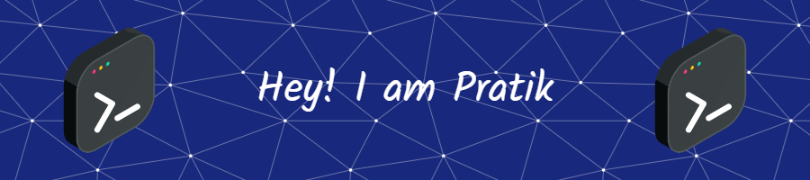

### Full-Stack Developer | AI/ML Enthusiast

I build full-stack web and mobile applications professionally (backend, frontend, and cloud deployment), and explore Generative AI / Agentic AI systems on the side. Most of my professional project work is under NDA with my current employer, so you won't find it in public repos here — but it's what I do day to day.

- 💼 Professionally building with **Node.js, FastAPI, React, React Native (Expo)** on **AWS & Azure**
- 🤖 Exploring **Generative AI & Agentic AI** (RAG, vector DBs, LLM-backed apps) in my own time
- 📫 Reach me: **pratik.devnal2@gmail.com**
- 🔗 [LinkedIn](https://linkedin.com/in/pratikdevnal)

---

### Tech Stack

**Frontend & Mobile**

**Backend**

**Cloud, DevOps & Tools**

**AI / ML (self-study)**

---

### Featured Project

**[AI-based Smart Gym Assistant](https://github.com/pratikdevnal/AI-based-Smart-Gym-Assistant)**
A computer-vision app using MediaPipe Pose to track exercise form in real time (e.g. bicep curls, overhead presses) and give spoken feedback to help prevent injury from bad form.

### Self-Study / Learning Repos

- **[FastAPI with GenAI & Agentic AI](https://github.com/pratikdevnal/FastAPI-with-GenAI-and-AgenticAI-project)** — production-style FastAPI backends across 9 projects: REST APIs, auth, WebSockets, and AI/RAG features.
- **[Full-Stack Generative & Agentic AI with Python](https://github.com/pratikdevnal/Full-stack-generative-and-Agentic-AI-with-python)** — hands-on coursework covering tokenization, agents, RAG, and vector databases.

---

### Connect

&nbsp;
&nbsp;
&nbsp;

